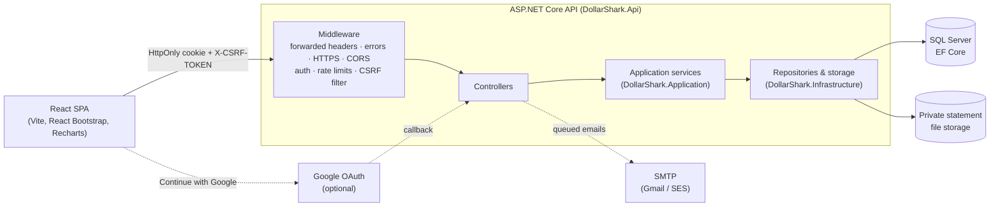
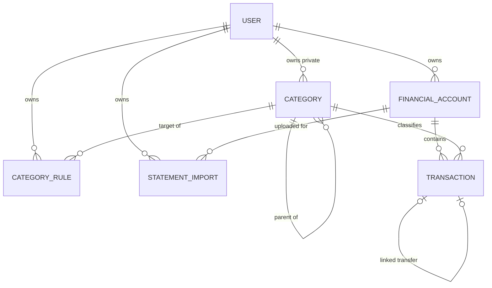
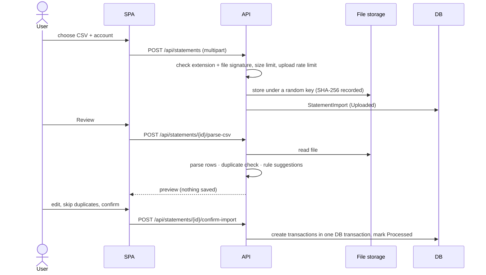

# DollarShark architecture

DollarShark is a multi-user ASP.NET Core API with a React single-page app. Every financial record belongs to exactly one user, and the API — not the browser — decides whose data a request can touch.

## Big picture

## Projects (clean architecture)

| Project | Owns | Depends on |
|---|---|---|
| `DollarShark.Domain` | Entities and pure rules: `FinancialAccount`, `Transaction` (balance effects), `Category`, `CategoryRule` (matching), `StatementImport`, `LinkedTransferRules` | nothing |
| `DollarShark.Application` | Use cases, validation and DTOs (`*Contracts.cs`): accounts, categories, rules, transactions, transfers, statements, dashboard; `UseCaseResult<T>` for success/validation/not-found/conflict | Domain |
| `DollarShark.Infrastructure` | EF Core `FinanceDbContext` + migrations, repositories, Identity user, statement CSV parser, file validator, local private file storage, account deletion | Application, Domain |
| `DollarShark.Api` | Composition root (`Program.cs`), controllers, security filters, email sending, rate limits, error handling | all of the above |
| `DollarShark.Tests` | xUnit unit and integration tests (in-memory SQLite) | all of the above |
| `frontend/` | React 19 + TypeScript SPA | the API over HTTP |

Controllers stay thin: they translate HTTP to a service call and a `UseCaseResult<T>` back to a status code. Business rules live in Application/Domain so they can be tested without HTTP.

## Security model

- **Authentication:** ASP.NET Core Identity with an HttpOnly, SameSite=Lax session cookie (8 hours, sliding; `Secure` in production). Passwords are salted hashes. Optional Google sign-in links to an Identity user.
- **Email confirmation** is required before first sign-in (configurable). The "confirm your email" response is only returned after a correct password so it can't reveal which emails are registered. Password-reset and confirmation links are signed tokens that expire after 3 hours; reset tokens are single-use.
- **CSRF:** every POST/PUT/PATCH/DELETE must send the antiforgery token from `GET /api/auth/csrf` in `X-CSRF-TOKEN` (`ApiCsrfAuthorizationFilter`). The token lives only in memory in the browser.
- **Per-user isolation:** repositories read the user ID from `ICurrentUserContext` (the signed-in principal) and filter every query by it; new rows get their `UserId` from the server, never from the request body. Foreign IDs (another user's account or category) behave as "not found". Integration tests cover cross-user reads, writes and references.
- **Abuse limits:** account lockout (5 wrong passwords → 15 minutes) plus per-IP rate limits on sign-in and email-sending endpoints and a per-user limit on statement uploads. Rejections return `429` with `Retry-After`.
- **Errors:** unhandled exceptions become a ProblemDetails response with a friendly title and `traceId` — never a stack trace. The browser wraps pages and dashboard content in React error boundaries.
- **Secrets** (connection string, SMTP password, Google client secret) come from User Secrets in development and environment variables in production — never from committed files.

## Data model rules

- **Signs:** expenses are negative; income and refunds are positive; transfers may use either sign and are their own type, excluded from income/expense totals.
- **Precision:** money is `decimal(19,4)`; dates are `DateOnly`. Each transaction uses its account's currency and totals are per currency (no conversion).
- **Balances:** an account's balance is its opening balance plus each transaction's *balance effect* (`Transaction.GetAccountBalanceEffect`), which flips for liabilities (credit cards show the amount owed).
- **Categories:** 13 shared defaults are seeded with fixed IDs (`CategorySeedData`); users add private categories. A category used by transactions or child categories can't be deleted.
- **Accounts** are deactivated softly (`IsActive`); history stays.
- **Linked transfers** pair an outgoing and incoming transfer in two of the user's accounts (different accounts, not already linked, same currency, equal amounts with opposite signs). Suggestions never link automatically.
- **Category rules** match a description by *contains / starts with / equals* (case-insensitive, whitespace-normalized). The lowest priority number wins, then the longest pattern, then the oldest rule.

## Statement import flow

Files are stored outside the web root, are never served back by the API, and are only parsed on request. Re-confirming the same statement is guarded by a per-statement lock and duplicate checks.

## Other flows

- **Dashboard** (`GET /api/dashboard/overview`) aggregates per currency for a date range and compares with the previous range of the same length; balance history is computed from opening balances and balance effects.
- **Account deletion** (`AccountDeletionService`) removes, in one database transaction, the user's transactions (unlinking transfers first), statement records, rules, private categories, accounts and Identity user, then deletes their stored files.
- **Emails** are queued in memory and sent by a background service (`EmailDispatchService`) through SMTP; in development they are written to the log instead.

## Configuration and environments

`Program.cs` validates configuration at startup and refuses to run with unsafe production settings (for example missing `FrontendOrigin`, missing `DataProtection:KeysPath`, or the development-only email log provider). Production settings are listed in the README and in [deployment.md](deployment.md). The API never applies migrations automatically.

## Frontend

- `src/api.ts` — one Axios instance with `withCredentials` and automatic CSRF token handling; `apiErrorMessage` turns ProblemDetails into friendly text.
- `src/AuthProvider.tsx` / `src/auth.ts` — session state (`/api/auth/me`), sign-in, sign-up, sign-out, account deletion.
- `src/App.tsx` — routes: public landing page and auth pages; everything else behind a signed-in shell with an error boundary per page.
- `src/pages/*` — one file per screen; `src/components/*` — shared pieces (auth layout, rules card, first-run guide, error boundary).

## Testing and CI

- **Unit tests** cover domain rules (balance effects, rule matching, starter rules).
- **Integration tests** start the real API with `WebApplicationFactory` on in-memory SQLite (shared-cache where requests run concurrently) and exercise HTTP endpoints end to end: auth, isolation, imports, transfers, dashboards, emails, Google sign-in (fake handler), rate limits, error handling and account deletion.
- **CI** (`.github/workflows/ci.yml`) runs the backend build + tests and the frontend lint + build on every pull request into `main`.
