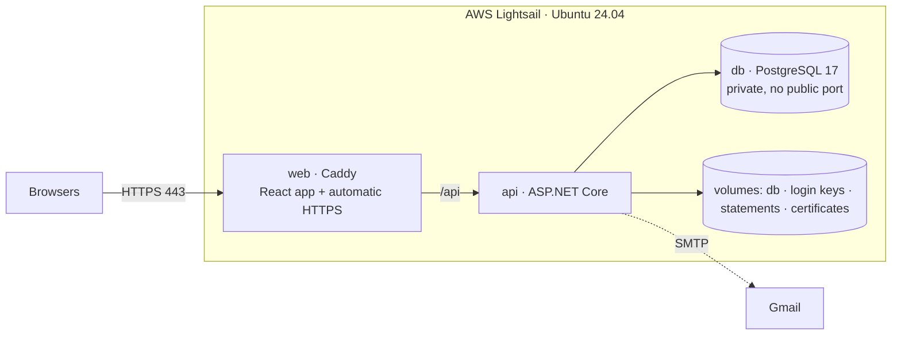
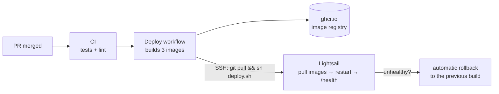

# Deploying DollarShark to AWS Lightsail

Everything runs with Docker Compose on one small Linux server:



| File | Purpose |
|---|---|
| `docker-compose.yml` | The three services, their settings and volumes |
| `.env.example` | Template for your secrets → copy to `.env` (never committed) |
| `backend/Dockerfile` | Builds and runs the API (non-root, port 8080) |
| `frontend/Dockerfile` + `frontend/Caddyfile` | Builds the React app and serves it with Caddy, which proxies `/api` and gets HTTPS certificates automatically |
| `backup/` | Nightly encrypted backups (database + statement files) to the server and S3, plus restore tools (section 7) |

The API applies database migrations itself on startup (`Database__MigrateOnStartup=true` in compose), so a deploy is just `docker compose up -d --build`.

## 1. Try it on your PC first (optional)

```powershell
copy .env.example .env     # then edit: use the "Local test" values from the comments
docker compose --profile local up -d --build
```

Open http://localhost:8088. Emails (confirmation, password reset) appear in Mailpit at http://localhost:8025. Stop with `docker compose --profile local down` (data stays in volumes).

## 2. AWS account (once)

1. Create an AWS account; turn on **MFA for the root user**.
2. **Billing → Budgets → Create budget**: a monthly cost budget of e.g. $10 with an email alert at 80%.

## 3. Create the server

1. Open **Lightsail** → **Create instance**.
2. Region: closest to your users (e.g. *Canada (Central)*). Platform **Linux/Unix** → **OS Only** → **Ubuntu 24.04 LTS**.
3. Plan: **1 GB RAM ($7/month)** is enough with PostgreSQL; 2 GB is smoother. (On the AWS Free plan only small sizes are allowed — if 1 GB is refused, the 512 MB plan can run the app too, but builds are slow.) Name it `dollarshark` → **Create**.
4. **Networking** tab of the instance:
   - **Create static IP** and attach it (the address never changes).
   - **IPv4 firewall**: keep SSH (22), keep HTTP (80), **add HTTPS (443)**. Nothing else.
5. **Snapshots** tab: turn on **automatic snapshots** — your simplest full-server backup.

## 4. Get a domain name

HTTPS (and therefore secure login cookies) needs a domain. Free option: **DuckDNS**.

1. Sign in at https://www.duckdns.org, create a subdomain, e.g. `dollarshark` → `dollarshark.duckdns.org`.
2. Set its **current ip** to your Lightsail static IP → **update ip**.

(Paid alternative: buy a domain in Route 53 or any registrar and add an **A record** pointing at the static IP.)

## 5. Set up the server (browser SSH)

In Lightsail click the **terminal icon** (Connect using SSH). Paste these one block at a time:

```bash
# Updates
sudo apt update && sudo apt -y upgrade

# 2 GB swap so builds don't run out of memory on small plans
sudo fallocate -l 2G /swapfile && sudo chmod 600 /swapfile && sudo mkswap /swapfile && sudo swapon /swapfile
echo '/swapfile none swap sw 0 0' | sudo tee -a /etc/fstab

# Docker (official install script) + permission to run it without sudo
curl -fsSL https://get.docker.com | sudo sh
sudo usermod -aG docker $USER
```

Close the SSH window and open it again (so the docker permission applies), then:

```bash
git clone https://github.com/Daxil44/DollarShark.git
cd DollarShark
cp .env.example .env
nano .env
```

Fill in `.env` (save: **Ctrl+O, Enter**, exit: **Ctrl+X**):

| Key | Value |
|---|---|
| `DB_PASSWORD` | a new strong password (no `$ " '` or spaces) |
| `SITE_ADDRESS` | `dollarshark.duckdns.org` |
| `SITE_URL` | `https://dollarshark.duckdns.org` |
| `HTTP_PORT` / `HTTPS_PORT` / `HTTPS_REDIRECT` | `80` / `443` / `true` |
| `SMTP_*` | your Gmail + **App Password** (see README → Sending real email with Gmail) |

## 6. Start it

```bash
docker compose up -d --build
```

The first build takes ~5–10 minutes. Then check:

```bash
docker compose ps                 # db "healthy", api and web "running"
docker compose logs -f api        # look for "Database migrations are up to date." — Ctrl+C to stop watching
```

Open **https://dollarshark.duckdns.org** 🎉 — Caddy fetches the HTTPS certificate on the first visit (can take ~30 seconds). Register, confirm the email, and invite friends.

## Everyday commands

| Task | Command |
|---|---|
| Deploy the latest code | Automatic when a PR merges (section 8). By hand: `cd ~/DollarShark && git pull && sh deploy.sh` |
| Roll back | `sh deploy.sh <commit-id>` |
| See status | `docker compose ps` |
| Logs | `docker compose logs -f api` (or `web`, `db`) |
| Restart everything | `docker compose restart` |
| Stop (data kept) | `docker compose down` |
| Disk usage / cleanup | `docker system df` · `docker image prune -f` |
| Backup now / restore test | `docker compose exec backup backup.sh` · `docker compose exec backup restore.sh test` |

⚠️ Never run `docker compose down -v` on the server — `-v` deletes the volumes, i.e. **all data and login keys**.

## 7. Backups

Two layers. Both cost pennies and come out of your AWS credits:

| Layer | What it saves | Protects against |
|---|---|---|
| **`backup` container** (in `docker-compose.yml`) | Every night: the database (`pg_dump`) + uploaded statement files, **encrypted** (AES-256), kept on the server (newest 7) **and** in a private S3 bucket (30 days) | A bad update, a deleted account by mistake, a dead server |
| **Lightsail automatic snapshots** | A daily copy of the whole server disk | The server breaking completely; quickest way back |

### 7a. Lightsail automatic snapshots (1 minute)

Lightsail → your instance → **Snapshots** tab → **Automatic snapshots** → **Enable**. Lightsail keeps the last 7 (about $0.05 per GB per month).

### 7b. S3 bucket (AWS console, ~10 minutes)

1. **S3 → Create bucket**
   - Region: **US East (Ohio) us-east-2**, the same as the server.
   - Name: globally unique, e.g. `dollarshark-backups-7k2q` (lowercase, add a few random characters).
   - **Block all public access: ON** (default). **Bucket Versioning: Enable**. Default encryption: SSE-S3 (default).
   - **Create bucket**.
2. Open the bucket → **Management → Create lifecycle rule**
   - Name `expire-old-backups`, scope **Apply to all objects** (tick the acknowledgement).
   - Tick **Expire current versions of objects** → **30** days.
   - Tick **Permanently delete noncurrent versions of objects** → **7** days.
   - Tick **Delete expired object delete markers or incomplete multipart uploads** → incomplete uploads after **1** day.
   - **Create rule**.
3. **IAM → Users → Create user** `dollarshark-backup`. Don't give it console access, and skip permissions on the first screen. Then **Create user**.
4. Open the user → **Add permissions → Create inline policy → JSON**. Paste this, replacing `YOUR-BUCKET` twice:

   ```json
   {
     "Version": "2012-10-17",
     "Statement": [
       { "Sid": "ListBackups", "Effect": "Allow", "Action": "s3:ListBucket",
         "Resource": "arn:aws:s3:::YOUR-BUCKET" },
       { "Sid": "ReadWriteBackups", "Effect": "Allow", "Action": ["s3:PutObject", "s3:GetObject"],
         "Resource": "arn:aws:s3:::YOUR-BUCKET/backups/*" }
     ]
   }
   ```

   Name it `dollarshark-backup-s3` → **Create policy**. The key can add and read backups in this one bucket, but **it can't delete anything**. Versioning keeps the old copy if a file is ever overwritten. So even a hacked server can't wipe your backups.
5. User → **Security credentials → Create access key** → choose **Application running outside AWS** → **Create**. Keep that page open: the secret is shown **only once**. Never paste it into chat or screenshots.

### 7c. Turn it on (server SSH)

```bash
cd ~/DollarShark && git pull
# Adds the backup settings with a random encryption passphrase:
cat >> .env <<EOF

BACKUP_PASSPHRASE=$(openssl rand -base64 32)
BACKUP_TIME_UTC=08:00
BACKUP_KEEP_LOCAL=7
BACKUP_S3_BUCKET=YOUR-BUCKET
BACKUP_AWS_REGION=us-east-2
BACKUP_AWS_ACCESS_KEY_ID=
BACKUP_AWS_SECRET_ACCESS_KEY=
EOF
nano .env     # fill in YOUR-BUCKET and the two access-key values at the bottom; save Ctrl+O Enter, exit Ctrl+X
grep BACKUP_PASSPHRASE .env
```

⚠️ **Copy the `BACKUP_PASSPHRASE` value into your password manager now.** Backups are encrypted with it. If the server dies and you no longer have the passphrase, the backups can't be opened.

```bash
docker compose up -d --build
docker compose logs backup      # expect "Saved /backups/..." and "Uploaded to s3://..."
```

The first backup runs right away, then every night at 08:00 UTC (3–4 am Toronto time). You'll see the file in the S3 console under `backups/`. `docker compose ps` shows the backup container as **unhealthy** if no backup has succeeded in the last 26 hours; when that happens, read `docker compose logs backup`.

### 7d. Restore

| Task | Command (on the server, in `~/DollarShark`) |
|---|---|
| Back up right now (e.g. before a risky update) | `docker compose exec backup backup.sh` |
| List backups (server + S3) | `docker compose exec backup restore.sh list` |
| **Restore test**: safe and no downtime. Restores into a throwaway database, compares row counts, then deletes it | `docker compose exec backup restore.sh test` (newest) or `... test dollarshark-20261122-080000.tar.gpg` |
| **Real restore**: replaces ALL live data | `docker compose stop api` → `docker compose exec backup restore.sh restore NAME --yes` → `docker compose start api` |

A real restore first saves the current data as `before-restore-*.tar.gpg`, so a restore can itself be undone. Backups that are no longer on the server are downloaded from S3 automatically.

**New server from scratch:** set up the server (sections 3–6) with the **same** `.env` values (`DB_PASSWORD`, `BACKUP_*`), run `docker compose up -d --build`, then do the real restore with a name from `restore.sh list`. Users will need to sign in again: login keys aren't part of the backup.

Practise the restore test once a month. A backup you've never restored is only a hope.

## 8. Automatic deployment (GitHub Actions)

After this setup, **merging a PR into `main` updates the live site by itself**:



Images are built on GitHub's machines, so the server no longer does 10-minute builds. Each image is tagged with its **commit id** (e.g. `1a2b3c4`), which is also how you roll back.

### 8a. A deploy key on the server (browser SSH)

The key can do **one thing only**: `git pull && sh deploy.sh`. Even if it ever leaked, it couldn't open a shell on your server.

```bash
ssh-keygen -t ed25519 -N "" -C github-deploy -f ~/github-deploy
echo "command=\"cd /home/ubuntu/DollarShark && git pull --ff-only --quiet && sh deploy.sh\",no-port-forwarding,no-agent-forwarding,no-X11-forwarding,no-pty $(cat ~/github-deploy.pub)" >> ~/.ssh/authorized_keys
```

Print the two values GitHub needs:

```bash
ssh-keyscan -t ed25519 localhost 2>/dev/null | sed "s/^localhost/3.146.186.253/"    # server's PUBLIC host key
cat ~/github-deploy                                                                  # PRIVATE deploy key
```

### 8b. GitHub secrets

GitHub → the DollarShark repo → **Settings → Secrets and variables → Actions → New repository secret**, three times:

| Name | Value |
|---|---|
| `DEPLOY_HOST` | `3.146.186.253` |
| `DEPLOY_KNOWN_HOSTS` | the line printed by `ssh-keyscan` (starts with `3.146.186.253 ssh-ed25519 …`) |
| `DEPLOY_SSH_KEY` | everything printed by `cat ~/github-deploy`, **including** the `-----BEGIN…` and `-----END…` lines |

Then delete the private key from the server. GitHub has the only copy now, and the server only needs the public half that's already in `authorized_keys`:

```bash
rm ~/github-deploy ~/github-deploy.pub
```

### 8c. First run

Merge the PR that adds `.github/workflows/deploy.yml`. In GitHub → **Actions** you'll see **CI** run, then **Deploy**: *Build api / web / backup image* → *Deploy to Lightsail*. The first build takes ~5–10 minutes; later ones reuse cached layers.

Then, once, make the images public so the server can also pull them **by hand** (for rollbacks): GitHub → your profile → **Packages** → `dollarshark-api` → **Package settings → Change visibility → Public**. Do the same for `dollarshark-web` and `dollarshark-backup`. They contain only the open-source app; all secrets live in the server's `.env`.

### 8d. Rollback and manual deploys (server)

| Task | Command (in `~/DollarShark`) |
|---|---|
| Which build is live? | `grep IMAGE_TAG .env` |
| **Roll back** to an earlier build | `sh deploy.sh 1a2b3c4` (commit id from GitHub → Commits, or from a Deploy run) |
| Deploy the newest build by hand | `git pull && sh deploy.sh` |
| Redeploy from GitHub | Actions → **Deploy** → **Run workflow** |
| Old way, build on the server (if GitHub is down) | `git pull && docker compose up -d --build` |

`deploy.sh` checks `/health` for up to 2 minutes after every deploy. If the new build is unhealthy, it shows the API logs and **switches back to the previous build automatically**, and the GitHub run turns red so you notice. Images older than 7 days are cleaned up to save disk space.

⚠️ The database migrates forward when a new build starts. Rolling back is safe while migrations only *add* things (new tables or columns). Before a migration that renames or deletes columns, take a backup first: `docker compose exec backup backup.sh`.

## Optional: Portainer (web UI for Docker)

```bash
docker volume create portainer_data
docker run -d --name portainer --restart=always -p 9443:9443 -v /var/run/docker.sock:/var/run/docker.sock -v portainer_data:/data portainer/portainer-ce:lts
```

In the Lightsail firewall add **TCP 9443 restricted to your own IP**, then open `https://<static-ip>:9443` within 5 minutes to create the admin user.

## Go-live checklist

- [ ] Budget alert set; root account has MFA.
- [ ] Only ports 22, 80, 443 open; the database has no public port.
- [ ] `https://` works and `http://` redirects to it.
- [ ] Sign up with a new email → confirmation email arrives → sign in. Password reset works.
- [ ] Restart (`docker compose restart`) and confirm you are still signed in.
- [ ] Two accounts can't see each other's data; upload + import a statement; delete a test account.
- [ ] Automatic snapshots on; nightly backups reach S3; `restore.sh test` passes; backup passphrase saved in a password manager.
- [ ] Privacy note: backups taken before an account deletion expire on their own schedule.

## Configuration reference

All API settings are set in `docker-compose.yml` from `.env`. See the README's *Production configuration* table for what each setting does (`FrontendOrigin`, `DataProtection:KeysPath`, `ReverseProxy:KnownNetworks`, `Https:*`, `Email:*`, rate limits, Google sign-in).
