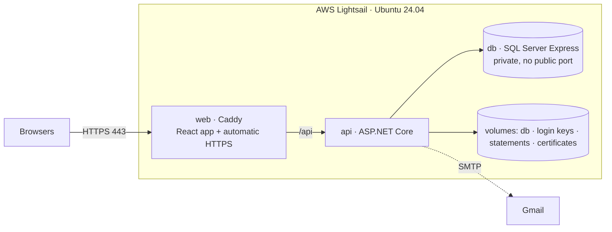

# Deploying DollarShark to AWS Lightsail

Everything runs with Docker Compose on one small Linux server:



| File | Purpose |
|---|---|
| `docker-compose.yml` | The three services, their settings and volumes |
| `.env.example` | Template for your secrets → copy to `.env` (never committed) |
| `backend/Dockerfile` | Builds and runs the API (non-root, port 8080) |
| `frontend/Dockerfile` + `frontend/Caddyfile` | Builds the React app and serves it with Caddy, which proxies `/api` and gets HTTPS certificates automatically |

The API applies database migrations itself on startup (`Database__MigrateOnStartup=true` in compose), so a deploy is just `docker compose up -d --build`.

## 1. Try it on your PC first (optional)

```powershell
copy .env.example .env     # then edit: use the "Local test" values from the comments
docker compose --profile local up -d --build
```

Open http://localhost:8088. Emails (confirmation, password reset) appear in Mailpit at http://localhost:8025. Stop with `docker compose --profile local down` (data stays in volumes).

## 2. AWS account (once)

1. Create an AWS account; turn on **MFA for the root user**.
2. **Billing → Budgets → Create budget**: a monthly cost budget of e.g. $10 with an email alert at 80%.

## 3. Create the server

1. Open **Lightsail** → **Create instance**.
2. Region: closest to your users (e.g. *Canada (Central)*). Platform **Linux/Unix** → **OS Only** → **Ubuntu 24.04 LTS**.
3. Plan: **at least 2 GB RAM** (SQL Server needs it); 4 GB is smoother. Name it `dollarshark` → **Create**.
4. **Networking** tab of the instance:
   - **Create static IP** and attach it (the address never changes).
   - **IPv4 firewall**: keep SSH (22), keep HTTP (80), **add HTTPS (443)**. Nothing else.
5. **Snapshots** tab: turn on **automatic snapshots** — your simplest full-server backup.

## 4. Get a domain name

HTTPS (and therefore secure login cookies) needs a domain. Free option: **DuckDNS**.

1. Sign in at https://www.duckdns.org, create a subdomain, e.g. `dollarshark` → `dollarshark.duckdns.org`.
2. Set its **current ip** to your Lightsail static IP → **update ip**.

(Paid alternative: buy a domain in Route 53 or any registrar and add an **A record** pointing at the static IP.)

## 5. Set up the server (browser SSH)

In Lightsail click the **terminal icon** (Connect using SSH). Paste these one block at a time:

```bash
# Updates
sudo apt update && sudo apt -y upgrade

# 2 GB swap so builds don't run out of memory on small plans
sudo fallocate -l 2G /swapfile && sudo chmod 600 /swapfile && sudo mkswap /swapfile && sudo swapon /swapfile
echo '/swapfile none swap sw 0 0' | sudo tee -a /etc/fstab

# Docker (official install script) + permission to run it without sudo
curl -fsSL https://get.docker.com | sudo sh
sudo usermod -aG docker $USER
```

Close the SSH window and open it again (so the docker permission applies), then:

```bash
git clone https://github.com/Daxil44/DollarShark.git
cd DollarShark
cp .env.example .env
nano .env
```

Fill in `.env` (save: **Ctrl+O, Enter**, exit: **Ctrl+X**):

| Key | Value |
|---|---|
| `DB_PASSWORD` | a new strong password (no `$ " '` or spaces) |
| `SITE_ADDRESS` | `dollarshark.duckdns.org` |
| `SITE_URL` | `https://dollarshark.duckdns.org` |
| `HTTP_PORT` / `HTTPS_PORT` / `HTTPS_REDIRECT` | `80` / `443` / `true` |
| `SMTP_*` | your Gmail + **App Password** (see README → Sending real email with Gmail) |

## 6. Start it

```bash
docker compose up -d --build
```

The first build takes ~5–10 minutes. Then check:

```bash
docker compose ps                 # db "healthy", api and web "running"
docker compose logs -f api        # look for "Database migrations are up to date." — Ctrl+C to stop watching
```

Open **https://dollarshark.duckdns.org** 🎉 — Caddy fetches the HTTPS certificate on the first visit (can take ~30 seconds). Register, confirm the email, and invite friends.

## Everyday commands

| Task | Command |
|---|---|
| Deploy the latest code | `cd ~/DollarShark && git pull && docker compose up -d --build` |
| See status | `docker compose ps` |
| Logs | `docker compose logs -f api` (or `web`, `db`) |
| Restart everything | `docker compose restart` |
| Stop (data kept) | `docker compose down` |
| Disk usage / cleanup | `docker system df` · `docker image prune -f` |

⚠️ Never run `docker compose down -v` on the server — `-v` deletes the volumes, i.e. **all data and login keys**.

## Optional: Portainer (web UI for Docker)

```bash
docker volume create portainer_data
docker run -d --name portainer --restart=always -p 9443:9443 -v /var/run/docker.sock:/var/run/docker.sock -v portainer_data:/data portainer/portainer-ce:lts
```

In the Lightsail firewall add **TCP 9443 restricted to your own IP**, then open `https://<static-ip>:9443` within 5 minutes to create the admin user.

## Go-live checklist

- [ ] Budget alert set; root account has MFA.
- [ ] Only ports 22, 80, 443 open; SQL Server has no public port.
- [ ] `https://` works and `http://` redirects to it.
- [ ] Sign up with a new email → confirmation email arrives → sign in. Password reset works.
- [ ] Restart (`docker compose restart`) and confirm you are still signed in.
- [ ] Two accounts can't see each other's data; upload + import a statement; delete a test account.
- [ ] Automatic snapshots on (Stage 7 adds S3 database backups and a restore test).
- [ ] Privacy note: backups taken before an account deletion expire on their own schedule.

## Configuration reference

All API settings are set in `docker-compose.yml` from `.env`. See the README's *Production configuration* table for what each setting does (`FrontendOrigin`, `DataProtection:KeysPath`, `ReverseProxy:KnownNetworks`, `Https:*`, `Email:*`, rate limits, Google sign-in).
